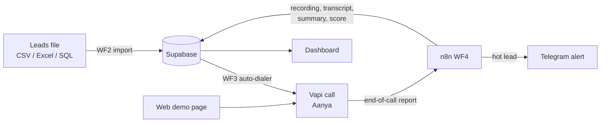

# Vaani — AI calling agent for Divyasree "Whispers of the Wind"

**Vaani** is an outbound AI voice agent. Its agent, **Aanya**, calls property leads as a **Divyasree consultant** and works through the qualification checkpoints from the assignment brief. Every call is then saved, summarised and scored automatically.

> Built for the Revspot assignment *"AI Voice Agent Design – Divyasree Whispers of the Wind"*.
>
> 🔗 **Live demo:** https://vaani-divyasree.vercel.app. Open **Talk to Aanya**, allow the microphone, and press **Start call**.
> 📄 System prompt: [`docs/System_Prompt.pdf`](docs/System_Prompt.pdf) · ✅ The **Assignment checklist** page in the app maps every line of the brief.

---

## What it does

1. **Calls the lead** and introduces itself as a Divyasree consultant, names the project and its location, and **asks permission to speak**.
2. **Qualifies the lead on 4 checkpoints:** intent (self-use or investment), geography (Nandi Hills corridor), budget (₹92.4 lakh+) and timeline (December 2029). It never asks again for something the lead has already said.
3. **Pitches** the "Private Valley" lifestyle: a 20,000 sq.ft. clubhouse, 74% open space and eco-parks.
4. **Books a callback** with a Property Expert.
5. **Saves everything:** recording, full transcript, AI summary, the hot / warm / cold score, mood and callback time.

**Bonus features from the brief**
- **Edge cases:** irritated user, budget fits but location doesn't, off-topic questions and more.
- **English + Hindi / Hinglish.**
- **Extra project details,** researched online.

---

## Example: one call, start to finish

```
Aanya: Hello Rahul! This is Aanya, a consultant from Divyasree Developers, calling about
       Whispers of the Wind near Nandi Hills. Is this a good time for two minutes?
Rahul: Haan, boliye. Investment ke liye dekh raha hoon, budget around 70 lakh.
Aanya: Samajh gayi. Plots 92.4 laakh se shuru hote hain, aur payments construction ke saath
       linked hain. Kya Nandi Hills aur Devanahalli ka area aapke liye theek hai?
  …     (timeline → pitch → expert callback booked for Friday 6 PM)
```
Rahul switched to Hindi and named his intent and budget in one sentence. Aanya switched language with him and didn't ask either question again.

After the call, this appears in the dashboard automatically:

| Interest | Intent | Budget | Location | Timeline | Callback | Mood |
|---|---|---|---|---|---|---|
| 🟡 Warm | Investment | Stretch (~₹70 L) | Yes | Yes | Fri 6 PM | calm → calm |

---

## How it works



| Part | Tool | Job |
|---|---|---|
| Voice call | **Vapi** | Listening, turn-taking, interruptions, recording |
| Ears | **Deepgram nova-3** (multi) | Speech to text, English + Hindi |
| Brain | **GPT-4.1-mini** (via Vapi credits) | Follows the system prompt and answers only from the facts |
| Voice | **ElevenLabs Flash v2.5** | Riya (default), Sia or Anika — Indian English + Hindi |
| Automation | **n8n** (Docker) | Saves calls, imports leads, auto-dials, alerts |
| Database | **Supabase** | Leads, calls, recordings (phone numbers masked in the dashboard) |
| Dashboard | Plain HTML + JS | Overview, Talk to Aanya, Leads, Calls, Campaign, Checklist |

**Why there's no RAG:** all the project facts fit inside the prompt (about 2k tokens). That makes answers faster, means a wrong document chunk can never be retrieved, and keeps the prompt cacheable. If the bot doesn't know something, it says *"our Property Expert will confirm that"* instead of guessing.

---

## Project layout

```
web/                  Dashboard + "Talk to Aanya" demo (static site, deployable to Vercel)
  js/campaign-data.js Facts, flow, voices, pronunciation — the single source of truth
prompts/              System prompt template
docs/                 System_Prompt.pdf, system_prompt.md, N8N_GUIDE.md
vapi/assistant.js     Vapi assistant config (voice, brain, interruptions, analysis)
supabase/schema.sql   Database tables + masked views + recordings bucket
n8n/                  4 workflows (generated by build_workflows.js)
scripts/              One-command helpers (see below)
docker-compose.yml    Runs n8n
```

---

## Setup (about 15 minutes)

You need Node 20+, Docker Desktop, and free accounts on Supabase, Vapi, ElevenLabs, Groq and Vercel. Cloudflare Tunnel needs no account.

1. **Keys:** copy `.env.example` to `.env` and fill it in. Keys go in the file, never in code or chat.
2. **Database:**
   ```bash
   npm run db:schema
   ```
3. **Automations:** start n8n, then import the workflows, then open http://localhost:5678 and switch them on.
   ```bash
   npm run n8n
   ```
   ```bash
   npm run n8n:import
   ```
4. **Create Aanya in Vapi.** This also fills the IDs into `web/js/config.js`.
   ```bash
   npm run sync
   ```
5. **Open a public link to n8n.** This uses a free Cloudflare tunnel with no account needed. Keep the window open. It updates `.env`, the web app, Vapi's webhook and the live site by itself.
   ```bash
   npm run tunnel
   ```
6. **Open the app:**
   ```bash
   npm run dev
   ```
   Go to http://localhost:5173 → **Talk to Aanya** → **Start call**.
7. **Real phone calls (optional).** Add `TWILIO_ACCOUNT_SID`, `TWILIO_AUTH_TOKEN` and `TWILIO_PHONE_NUMBER` to `.env`, then run the command below. After that, use **Leads → Call now**, or let the auto-dialer call new leads between 10 AM and 7 PM IST.
   ```bash
   npm run twilio
   ```

Full n8n walkthrough: [`docs/N8N_GUIDE.md`](docs/N8N_GUIDE.md).

## Handy commands

| Command | What it does |
|---|---|
| `npm run tunnel` | Public link for n8n; updates Vapi + the live site automatically |
| `npm run deploy` | Publish the dashboard to https://vaani-divyasree.vercel.app |
| `npm run twilio` | Connect a Twilio number to Aanya for real phone calls |
| `npm run n8n:activate` | Re-import and switch on all n8n workflows |
| `npm run sync` | Rebuild the system prompt and update Aanya in Vapi |
| `npm run prompt` | Only rebuild `docs/system_prompt.md` (no keys needed) |
| `npm run pdf` | Export `docs/System_Prompt.pdf` |
| `npm run voices` | Pull your ElevenLabs voices (with previews) into the voice picker |
| `npm run db:schema` | Create or update the database |
| `npm run n8n` / `n8n:stop` / `n8n:logs` | Run n8n in Docker |

## Reuse it for another business

Everything Aanya knows comes from `web/js/campaign-data.js`. To use Vaani for, say, a hospital calling patients for check-ups:
1. Change the persona, flow, facts and pronunciation in that file. You can also paste a document into n8n's **Knowledge builder** to draft the facts automatically.
2. Run `npm run sync`.
3. Upload the patient list on the **Leads** page.

There's no code to change.

## Privacy and safety
- Private keys live only in `.env` (git-ignored). The browser only gets public keys.
- The browser's Vapi key is **locked** to this site and to Aanya, so nobody can reuse it elsewhere to spend credits.
- Every call is capped at 4 minutes and hangs up after 15 seconds of silence. "Call now" asks for confirmation first.
- The dashboard reads through views that **mask phone numbers**. Only n8n can write to the database.
- Aanya never invents prices, EMIs or discounts. She admits she's an AI if asked, and stops calling anyone who says "don't call".
