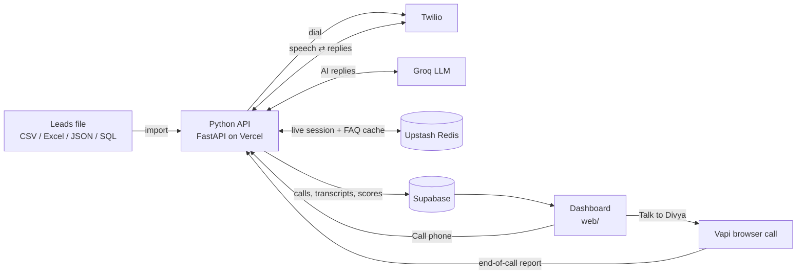

# Whispers of the Wind (WOW) by Divyasree Developers — AI voice agent "Divya"

An outbound AI voice agent for **Whispers of the Wind (WOW) by Divyasree Developers**. The agent, **Divya**, calls property leads as a **Divyasree consultant** and follows the assignment's conversation flow. Every call is then saved, summarised and scored automatically.

> Built for the Revspot assignment *"AI Voice Agent Design – Divyasree Whispers of the Wind"*.
>
> 🔗 **Live demo:** https://vaani-divyasree.vercel.app. Open **Talk to Divya**, allow the microphone, and press **Start call**.
> 📞 **Get a real phone call:** open **Leads**, then **Want Divya to call you?**, verify your number (about 30 s), and press **Call me now**.
> 📄 **System prompt:** [`docs/System_Prompt.pdf`](docs/System_Prompt.pdf) · ✅ The **Assignment checklist** page in the app maps every line of the brief.

---

## What it does

1. **Introduction:** Divya introduces herself as a Divyasree consultant, names the project and its location near Nandi Hills, and **asks permission to speak**.
2. **Qualification, the 4 checkpoints, in order:** intent (self-use or investment), geography (the Nandi Hills / Devanahalli corridor), budget (₹92.4 lakh+) and timeline (phased delivery, December 2029). She never asks again for something the lead already said.
3. **The pitch:** the "Private Valley" lifestyle, with 74% open green space, eco-parks, a 20,000 sq.ft. clubhouse and a like-minded community.
4. **CTA:** she books a follow-up call with a **Property Expert**, and lets the lead choose the day and time.
5. **Saves everything:** the full transcript, an AI summary, a hot / warm / cold score, each checkpoint's answer, mood and callback time.

**Bonus points from the brief**

| Bonus | How Divya handles it |
|---|---|
| **Edge cases** | **Budget fits, location doesn't:** treats it as a weekend escape (30 min to the airport, 10 min to STRR), stresses the growth corridor and future exposure, then offers to show how buyers hold it purely as an investment. **Location fits, budget doesn't:** explains that payments are staged until 2029 (not all upfront), that plot loans keep the monthly outgo light, that the buyer enters early in a growth corridor, and that "the gap is only about X lakh", then closes politely. **Irritated, angry or busy:** apologises, keeps it short, offers a callback, or ends the call. |
| **English + Hindi** | Switches to Hinglish when the lead does, and back to English when they do. |
| **Extra project details** | Facts researched online: 38 acres, about 207 plots, RERA, about ₹7,700 per sq.ft., schools, hospitals and distances. |

Persuasion stays **truthful**. Divya never quotes an EMI amount, a down payment, a discount or a guaranteed return; the Property Expert confirms exact numbers.

---

## Example: one real phone call (shortened)

```
Divya: Hello Rahul! This is Divya, a consultant from Divyasree Developers, calling about Whispers of the
       Wind, our villa plot community near Nandi Hills in North Bengaluru. Is this a good time for two minutes?
Rahul: Yes.
Divya: Great! Are you looking for a weekend home or an investment?
Rahul: Both. And what are the amenities, nearby schools, and how far is the airport?
Divya: A 20,000 sq ft clubhouse, pool, gym, sports courts and eco-parks; GITAM and Stonehill International
       School are nearby; the airport is about 30–35 minutes away. Are you comfortable with the Nandi Hills side?
Rahul: Yes. But my budget is around 80 lakhs.
Divya: Understood, and many of our buyers started with a similar budget. Payments are staged with construction
       until December 2029, so you don't pay it all upfront, and our Property Expert can arrange plot-loan
       options... Shall I have our expert show you a payment plan around your budget?
Rahul: Yeah sure. Tomorrow around 1 pm.
Divya: Perfect, a short Property Expert call tomorrow at 1 pm. Thank you, Rahul. Have a great day!
```

After the call, this appears on the **Calls** page automatically:

| Interest | Intent | Budget | Location | Timeline | Callback |
|---|---|---|---|---|---|
| 🟡 Warm | Weekend home + investment | Below entry (~₹80 L) | Yes | Yes | Tomorrow 1 PM |

---

## How it works



| Part | Tool (all free tiers) | Job |
|---|---|---|
| Dashboard | Plain HTML + JS | Overview, Talk to Divya, Phone voices, Leads, Calls, Campaign, Checklist |
| Backend | **Python FastAPI** on Vercel | Saves calls, imports leads, places phone calls, runs the phone conversation |
| Browser calls | **Vapi** (Deepgram nova-3, GPT-4.1-mini, ElevenLabs Flash v2.5) | Low-latency voice demo with interruptions, English + Hindi |
| Phone calls | **Twilio** trial | Rings the lead, turns speech into text, and speaks with a premium voice (Google Chirp3-HD) |
| Phone brain | **Groq** (gpt-oss-120b / 20b) | Writes each reply from the compact system prompt |
| Cache | **Upstash Redis** | Live call sessions (about 15 ms) and **zero-token answers** to the most-asked questions |
| Database | **Supabase** | Leads, calls and analysis (the dashboard sees masked phone numbers) |

**Speed and cost tricks**
- **FAQ cache:** price, amenities, schools, hospitals, location, possession, RERA and payment questions are answered from facts in Redis, in English or Hindi, using **0 AI tokens**.
- **Prompt caching:** the system prompt is identical on every turn, so the provider reuses it.
- **Reply budget:** if the AI takes longer than 3 s, Divya answers from the script instead of going silent.
- **Guardrails in code:** Divya never invents a meeting time, covers all 4 checkpoints before the pitch and CTA, and every reply ends with the next question.

**Why there's no RAG:** all the project facts fit inside the prompt (about 2.6k tokens). That is faster, means a wrong document chunk can never be retrieved, and keeps the prompt cacheable. If Divya doesn't know something, she says *"our Property Expert will confirm that"*.

---

## Using the app

| Page | What you can do |
|---|---|
| **Talk to Divya** | Talk to her in the browser, as a generic lead or as a lead from your list (`#/talk/<leadId>`). |
| **Phone voices** | Press ▶ to hear 7 phone voices, and pick the one used on every phone call. |
| **Leads** | Import any lead file (columns are detected automatically), add a lead by hand, verify a number, or press **Call phone**. |
| **Calls** | See each call's transcript, summary, score, checkpoints and callback time. |
| **Campaign & knowledge** | Facts, flow, edge cases and pronunciation: everything Divya knows. |
| **Assignment checklist** | Every requirement of the brief and where it is covered. |

### About the free Twilio trial
- It can only call **verified** numbers. Anyone can verify their own number on the **Leads** page: Twilio rings them, and they type the 6-digit code shown on screen.
- Every trial call starts with Twilio's short trial message ("press any key"). A paid Twilio account removes it.
- Phone networks carry 8 kHz audio, which is why the phone voices are HD voices built for phone lines.

---

## Project layout

```
api/index.py            Vercel entry point for the Python API
backend/                FastAPI app
  main.py               All /api routes
  phone_agent.py        Phone conversation loop (Twilio speech ⇄ Groq), compact prompt, call analysis
  faq.py                Zero-token FAQ answers, objection handling, checkpoint tracker, guardrails
  voices.py             Phone voice library, chosen voice, browser preview token
  phone.py              Places calls, verifies numbers
  calls.py              Saves Vapi browser calls (transcript, recording, analysis)
  leads.py              Lead import with AI column mapping
  cache.py              Redis sessions + FAQ cache
  stream_agent.py       Live-audio streaming engine (off: the Twilio trial blocks Media Streams)
web/                    Dashboard (static site)
  js/campaign.json      Facts, flow, edge cases, FAQ answers, voices: the single source of truth
prompts/                System prompt template
docs/                   System_Prompt.pdf, system_prompt.md, evaluation reports
supabase/schema.sql     Tables, masked views, recordings bucket
scripts/                Helpers: sync assistant, apply schema, evaluate, export PDF
n8n/                    Earlier automation version (replaced by the Python API, kept for reference)
```

---

## Setup

You need **Python 3.11+**, **Node 20+**, and free accounts on Supabase, Vapi, Groq, Twilio, Upstash and Vercel.

1. **Keys:** copy `.env.example` to `.env` and fill it in. Keys go in that file, never in code or chat.
2. **Python packages:**
   ```bash
   python -m venv .venv
   ```
   ```bash
   .venv/Scripts/pip install -r requirements.txt -r requirements-dev.txt
   ```
   (On macOS or Linux, use `.venv/bin/pip`.)
3. **Database:**
   ```bash
   npm run db:schema
   ```
4. **Create or update Divya in Vapi.** This also writes the public IDs into `web/js/config.js`:
   ```bash
   npm run sync
   ```
5. **Run locally:** run the dashboard on http://localhost:5173. Local pages use the live API.
   ```bash
   npm run dev
   ```
   To run the API yourself on http://localhost:8000:
   ```bash
   npm run api
   ```
6. **Publish the site and API to Vercel.** First add the same keys from `.env` as Vercel environment variables.
   ```bash
   npm run deploy
   ```

## Handy commands

| Command | What it does |
|---|---|
| `npm run dev` | Dashboard on http://localhost:5173 |
| `npm run api` | Python API on http://localhost:8000 (API docs at `/docs`) |
| `npm run deploy` | Publish the dashboard and API to https://vaani-divyasree.vercel.app |
| `npm run sync` | Rebuild the system prompt and update Divya in Vapi |
| `npm run prompt` | Rebuild `docs/system_prompt.md` only (no keys needed) |
| `npm run pdf` | Export `docs/System_Prompt.pdf` |
| `npm run eval` | Run the conversation test scenarios → `docs/eval_report.md` |
| `npm run db:schema` | Create or update the database |

## Reuse it for another business

Everything Divya knows lives in `web/js/campaign.json`: persona, flow, facts, FAQ answers, objections, pronunciation and voices. To reuse this agent for, say, a hospital calling patients for check-ups:
1. Edit that file. You can also send a document to `POST /api/knowledge/build` to draft the facts automatically.
2. Run `npm run sync`, then `npm run deploy`.
3. Upload the patient list on the **Leads** page.

There's no code to change.

## Privacy and safety
- Private keys live only in `.env` (git-ignored) and in Vercel's environment variables. The browser only gets public keys.
- The browser's Vapi key is **locked** to this site and to Divya, so nobody can reuse it elsewhere.
- Twilio requests are checked against the account, and number verification is rate-limited, to prevent abuse.
- The dashboard reads through views that **mask phone numbers**; only the backend writes to the database.
- Calls are capped in length. "Call phone" asks for confirmation first.
- Divya never invents prices, EMIs or discounts. She admits she's an AI if asked, and never calls again anyone who says "don't call".
